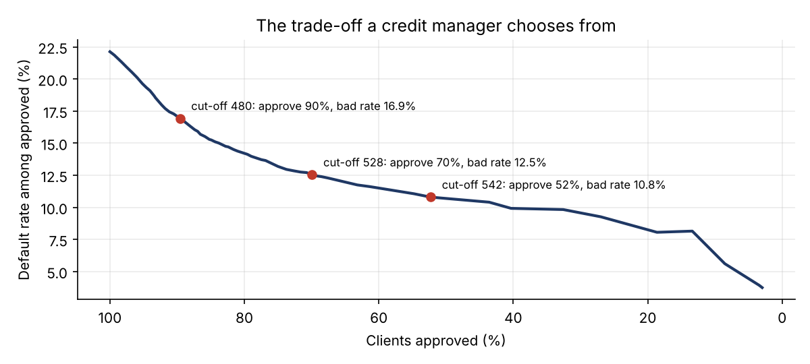

# Credit Risk Scorecard

A credit scorecard and expected credit loss model for 30,000 credit card clients, built the way a bank's credit risk team typically would: Weight of Evidence binning, logistic regression, a points-based scorecard, out-of-sample validation, and expected loss using PD × LGD × EAD.

Dylan Ambrose Amerton, Actuarial Studies, Sunway University

[Notebook](notebooks/credit_scorecard.ipynb) | [Run in Google Colab](https://colab.research.google.com/github/DylanAmbrose892/credit-risk-scorecard/blob/main/notebooks/credit_scorecard.ipynb)

## Data

Yeh, I. (2009). *Default of Credit Card Clients*. UCI Machine Learning Repository. https://doi.org/10.24432/C55S3H (CC BY 4.0)

30,000 credit card clients in Taiwan, April to September 2005. For each client: credit limit, six months of repayment status, bill amounts and payments, and whether they defaulted the following month (22.1% did). Amounts are in New Taiwan dollars.

## Results

Model performance on the 30% test set (9,000 clients):

| Model | Inputs | Gini | KS |
|---|---|---|---|
| Scorecard | 5 behavioural characteristics | 0.501 | 0.392 |
| Gradient boosting | 19 behavioural columns | 0.548 | 0.413 |
| Gradient boosting | 19 behavioural + 4 demographic | 0.555 | 0.419 |

Default rate by score band (test set, 10 equal-sized bands):

| Band | 1 (lowest) | 2 | 3 | 4 | 5 | 6 | 7 | 8 | 9 | 10 (highest) |
|---|---|---|---|---|---|---|---|---|---|---|
| Default rate | 67.6% | 40.1% | 25.7% | 19.0% | 15.4% | 13.7% | 11.0% | 11.8% | 10.2% | 6.8% |

Recent repayment behaviour carries most of the signal. Clients who were two or more months late in September defaulted about 70% of the time, compared with 13–17% for clients who were up to date.

The scorecard gives up some ranking power against gradient boosting (Gini 0.50 vs 0.55), but every point it assigns can be explained. Demographics were left out on purpose; adding them to the gradient boosting model changed Gini by less than 0.01.

The model is well calibrated: the average predicted default rate on the test set is 22.0% against an actual 22.1%. Training and test Gini are close (0.53 vs 0.50).

Approving the top 70% of clients (score 528 and above) lowers the default rate among approved clients from 22.1% to 12.5%.




## Scorecard

Scaling: 600 points corresponds to odds of 50:1, and every 20 points doubles the odds. A client's score is the sum of the points for their five bins; the full points table is in the notebook.

| Characteristic | Description | Information Value |
|---|---|---|
| latest_status | Repayment status in the most recent month | 0.89 |
| months_late_6m | Number of late months in the last six | 0.87 |
| credit_limit | Credit limit | 0.17 |
| avg_util_6m | Average balance divided by limit, last six months | 0.11 |
| repayment_ratio | Share of last month's bill repaid | 0.09 |

## Expected credit loss

Expected loss is PD × LGD × EAD, where PD comes from the scorecard, EAD is the current balance plus 50% of the unused limit, and LGD is 75%. The dataset contains no recovery information, so LGD and the 50% credit conversion factor are assumptions.

| Credit conversion factor | LGD 60% | LGD 75% | LGD 90% |
|---|---|---|---|
| 25% | 83 | 104 | 125 |
| 50% | 107 | 134 | 161 |
| 75% | 131 | 164 | 197 |

*Expected credit loss on the test portfolio, NT$ million. Total exposure at CCF 50%: NT$989 million.*

## Limitations

- The data comes from Taiwan's 2005 credit card debt crisis, so the default rate is far higher than in a normal portfolio.
- This is a behavioural scorecard for existing customers, not an application scorecard.
- The target is default in the next month; IFRS 9 provisioning needs 12-month and lifetime PDs.
- LGD and CCF are assumed rather than estimated.
- The train/test split is random; a time-based split would be a stricter test.

## Structure

```
creditrisk/core.py                 characteristics, WoE/IV, scorecard, validation, expected loss
notebooks/credit_scorecard.ipynb   analysis and charts
tests/test_core.py                 unit tests
data/                              original UCI file
figures/                           charts
```

```
pip install -r requirements.txt
pytest
jupyter notebook notebooks/credit_scorecard.ipynb
```
