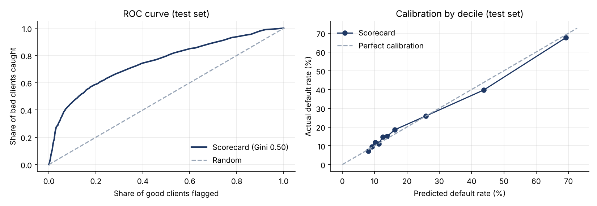
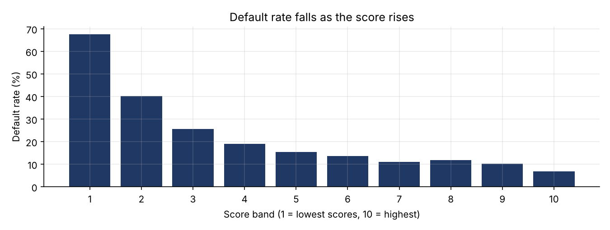

# Credit card default: a bank-style credit scorecard and expected credit loss

**Dylan Ambrose Amerton** · Actuarial Studies, Sunway University · [LinkedIn](https://linkedin.com/in/dylan-ambrose-amerton)

A bank has 30,000 credit card customers. Which ones will miss next month's payment, and how much should the bank expect to lose? This project answers that the way a bank's credit risk team would: **Weight of Evidence binning → logistic regression → points scorecard → validation → expected credit loss (PD × LGD × EAD)**.

**[Open the notebook](notebooks/credit_scorecard.ipynb)** · [Run it in Google Colab](https://colab.research.google.com/github/DylanAmbrose892/credit-risk-scorecard/blob/main/notebooks/credit_scorecard.ipynb)

## Key results

| | |
|---|---|
| Clients / default rate | 30,000 / 22.1% (70% train, 30% test) |
| Characteristics used | 5, all behavioural (no demographics) |
| **Test Gini / KS** | **0.50 / 0.39** (train 0.53 / 0.42: no meaningful overfitting) |
| Calibration | Predicted average PD 22.0% vs actual 22.1% |
| Default rate, lowest vs highest score band | **67.6% vs 6.8%** |
| Benchmark: gradient boosting, 19 behaviour columns | Gini 0.55 |
| Adding sex, age, education, marital status | Gini +0.007 (almost nothing) |
| Expected credit loss, test portfolio | NT$134M on NT$989M exposure (13.6%) |

**1. Recent repayment behaviour dominates.** Clients two or more months late default about 70% of the time, compared with 13–17% for those up to date. The two repayment characteristics have Information Values near 0.9.

**2. A simple, explainable scorecard gives up little.** Five characteristics turned into points reach a Gini of 0.50, against 0.55 for a black-box gradient boosting model on all the raw columns.

**3. Fairness is nearly free.** Adding demographics to the black-box model improves Gini by just 0.007, so leaving them out costs almost nothing in accuracy.

**4. The score drives real decisions.** Approving the top 70% of clients (cut-off 528) cuts the default rate among approved clients from 22.1% to 12.5%. The lowest score band holds 24% of expected losses with only 7% of the exposure.





## The scorecard

Scaling: **600 points = odds of 50:1**, and every **20 points doubles the odds** of being good. A client's score is the sum of the points for their bins. The full points table is in the notebook.

| Characteristic | Meaning | IV |
|---|---|---|
| `latest_status` | Repayment status in the most recent month | 0.89 |
| `months_late_6m` | Months late out of the last 6 | 0.87 |
| `credit_limit` | Credit limit granted | 0.17 |
| `avg_util_6m` | Average balance ÷ limit over 6 months | 0.11 |
| `repayment_ratio` | Share of last month's bill repaid | 0.09 |

## Expected credit loss

`EL = PD × LGD × EAD`, with PD from the scorecard, **EAD** = balance + 50% of the unused limit, and **LGD** = 75%. The data has no recovery information, so LGD and the 50% conversion factor are stated assumptions. The notebook shows EL across LGD 60–90% and CCF 25–75% (NT$83M–197M).

## Limitations

- Taiwan, 2005: the data comes from a card-debt crisis, so the 22% default rate is far above normal. The method transfers; the numbers don't.
- Behavioural scorecard for existing customers, not an application scorecard for new ones.
- One-month default horizon; IFRS 9 needs 12-month and lifetime PDs.
- LGD and CCF are assumed rather than estimated.
- A live scorecard would be monitored for drift (Population Stability Index) and recalibrated.

## Project structure

```
creditrisk/core.py                  characteristics, WoE/IV, scorecard, validation, expected loss
notebooks/credit_scorecard.ipynb    the full analysis, with charts
tests/test_core.py                  unit tests (pytest)
data/                               UCI dataset (original .xls)
figures/                            charts produced by the notebook
```

```bash
pip install -r requirements.txt
pytest
jupyter notebook notebooks/credit_scorecard.ipynb
```

**Data:** Yeh, I. (2009). *Default of Credit Card Clients* [Dataset]. UCI Machine Learning Repository. https://doi.org/10.24432/C55S3H. Licensed under CC BY 4.0.
